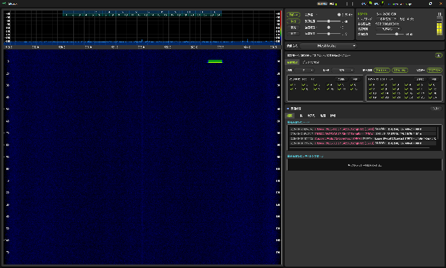

# SRdeck

[](https://github.com/sake846/SRdeck/wiki)
[](https://github.com/sake846/SRdeck/wiki/Getting-Started)
[](https://github.com/sake846/SRdeck/wiki/Plugins-Overview)

SRdeck is the host application and public plugin platform for the SRdeck SDR
suite.  This repository contains a versioned release snapshot.

## SRdeck Screenshot



Do not commit product changes directly to this repository.  Use the project's
normal development and review process for product changes.

## 📖 Documentation & Wiki

Comprehensive user guides, plugin documentation, troubleshooting, and developer tutorials are available on the [SRdeck Official Wiki](https://github.com/sake846/SRdeck/wiki):

- 🔰 **Getting Started**: [System Requirements](https://github.com/sake846/SRdeck/wiki/System-Requirements) / [Installation](https://github.com/sake846/SRdeck/wiki/Installation) / [First Reception](https://github.com/sake846/SRdeck/wiki/Getting-Started)
- 🎛️ **Operation & UI**: [UI Overview](https://github.com/sake846/SRdeck/wiki/UI-Overview) / [SDR Source Settings](https://github.com/sake846/SRdeck/wiki/SDR-Source-Settings) / [Spectrum & Waterfall](https://github.com/sake846/SRdeck/wiki/Spectrum-and-Waterfall)
- 🔌 **Plugins**: [Official Plugins Overview](https://github.com/sake846/SRdeck/wiki/Plugins-Overview) / [Plugin Management](https://github.com/sake846/SRdeck/wiki/Plugin-Management)
- ❓ **Support & FAQ**: [FAQ](https://github.com/sake846/SRdeck/wiki/FAQ) / [Troubleshooting](https://github.com/sake846/SRdeck/wiki/Troubleshooting)
- 💻 **Plugin Development**: [Developer Overview](https://github.com/sake846/SRdeck/wiki/Developer-Overview) / [Development Environment](https://github.com/sake846/SRdeck/wiki/Development-Environment) / [Creating First Plugin](https://github.com/sake846/SRdeck/wiki/Creating-First-Plugin)

## Release metadata

- Release version: `1.0.8`

## Contents

- `SRdeck` — Windows host application
- `SRdeckPlugin.Contracts` — stable host/plugin contracts
- `SRdeckPlugin.Sdk` — plugin lifecycle and development helpers
- `SRdeckPlugin.Wpf` — shared WPF controls and themes
- `SRdeckCore.SignalProcessing` — modulation-independent DSP components
- `docs` — plugin specifications, guides, and samples

## Building

Install these prerequisites first:

- Windows x64 and the .NET 10 SDK (the Desktop Runtime alone cannot build sources).
- The **Desktop development with C++** workload in Visual Studio or Build Tools:
  - MSVC x64/x86 build tools (v143 for VS 2022; v145 for VS 2026).
  - A Windows 10 or Windows 11 SDK.
  - C++ CMake tools for Windows, or a separate CMake installation.
- CMake **3.21 or newer for VS 2022; 4.2 or newer for VS 2026**. Add it to
  `PATH`, or set the `CMAKE_EXE` environment variable to its full executable path.
- An internet connection for the first NuGet restore.

After installing the prerequisites, double-click `build.bat` beside
`SRdeck.sln`. To run it from Command Prompt, use this command from the source root:

```cmd
build.bat
```

The BAT file checks that `dotnet` is available, restores dependencies, and builds the
solution in Release x64 configuration. It uses its own folder as the working
directory, so it also works when launched from another folder. The window waits
for a key press at the end so you can read the result.

Optional arguments select the configuration and whether to skip the final key
press (for automated builds):

```cmd
build.bat Debug
build.bat Release --no-pause
```

Restore or build failures stop the script and return a nonzero exit code.
In PowerShell, use `.\build.bat` instead of `build.bat`. The resulting executable is:

```text
SRdeck\bin\x64\Release\net10.0-windows\win-x64\SRdeck.exe
```

For Debug builds, replace `Release` in the output path with `Debug`.

This build also compiles the native DLLs in `SRdeck/native/sr_fft` and
`SRdeck/native/sr_gpu` with CMake and copies them to the application output
directory. Setting `EnableRx888=true` also builds `sr_rx888`.
See [Development Environment](docs/wiki/Development-Environment.md) for a
native toolchain check and CMake troubleshooting. The automatic build passes
`-A x64`, so use a Visual Studio generator.

The existing project settings select a supported Visual Studio's bundled
CMake or CMake on `PATH`. To choose a different executable, set `CMAKE_EXE`
in Command Prompt and run the BAT in the same window:

```cmd
set "CMAKE_EXE=C:\Program Files\CMake\bin\cmake.exe"
build.bat
```

The host source snapshot does not embed or build the optional plugins.  Those
are published separately in the `SRdeckPlugins` repository.

## Executable packages

The matching GitHub Release provides framework-dependent Windows x64 packages:

- `SRdeck-1.0.8-win-x64-host-only.zip` — host application without optional plugins.
- `SRdeck-1.0.8-win-x64-with-plugins.zip` — host application with the published plugin set.

The packages include `SRdeck.exe`, legal/security documents, dependency notices,
and a `PACKAGE-MANIFEST.json`. Install the .NET 10 Desktop Runtime (x64) before
running SRdeck. The Windows WebView2 Runtime is also required for features that
use embedded web content.
