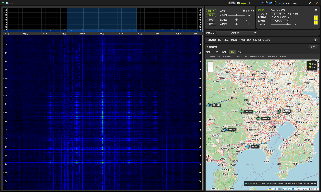

# ADS-Bプラグイン

プラグインIDは`adsb`です。1090 MHzのADS-B信号を受信し、航空機の情報を表示します。

Mode S Extended SquitterのDF17／DF18から、機体識別、高度、速度、トラック、垂直速度、CPR位置を解析します。

## 画面例



## 受信条件

| 項目 | 内容 |
|---|---|
| 中心 | 1,090,000,000 Hz |
| 信号 | Mode S PPM |
| 主なDF | DF17、DF18 |
| ホスト入力 | 2 MS/s以上 |
| 標準チャネル | 1.85 MHz帯域、4 MS/s出力を優先 |
| 検証 | Mode Sプリアンブル、PPM、CRC。1-bit訂正統計も表示 |

1090 MHzに対応するアンテナ、低損失な給電、見通しが受信距離へ大きく影響します。強い近接送信所ではゲイン最大が最適とは限りません。

## 受信機位置

`受信機緯度`と`受信機経度`は、地上CPR（Surface Position）の90度領域（アンビギュイティ解決）を決めるために使います。

- **入力形式**: 十進数度（Decimal Degrees、例: `35.6812`、`139.7671`）
  - 度分秒形式（例: `35°40'52"N`）ではなく、数値をそのまま入力します。
  - 北緯・東経は正の数、南緯・西経は負の数（`-`）です。
- **有効範囲**:
  - 緯度: -90～90
  - 経度: -180～180
  - 未設定または範囲外: nullとして扱う（空欄にすると未設定に戻ります）
- **位置情報の用途**: 地上CPR位置算出、ローカルCPR復号の基準点、地図表示の補助
- **必要な精度**:
  - 受信機位置は領域決定にのみ使われ、復号される機体位置の精度そのものには影響しません。
  - アルゴリズム上は約45海里（約83 km）以内の誤差が許容されるため、小数点以下2～3桁程度（誤差1 km～100 m）の入力で十分機能します。
- **プライバシーへの配慮**:
  - 受信機位置を公開エクスポートやスクリーンショットに含める可能性を考慮し、自宅の正確な座標ではなく最寄り駅や市区町村役場、または小数点以下2～3桁に丸めた座標の利用を推奨します。

## 最初の受信

1. 1090 MHz用アンテナを接続します。
2. RATEを2 MS/s以上にします。
3. `MODE`で`ADS-B`を選びます。
4. 受信機緯度経度を設定します。
5. `Start`を押します。
6. スペクトラムに短い広帯域パルスが現れることを確認します。
7. `診断`でプリアンブル検出、CRC合格、DF17／18を確認します。
8. `一覧`と`地図`で機体状態を確認します。

開始が拒否される場合は、まずRATEが2 MS/s以上かを確認してください。

## ワークスペース

### 概要

受信機体数、有効フレーム、合格率、最終受信、最近の機体を表示します。空域が混雑していても有効フレームが増えない場合は、過入力や帯域不足を疑います。

### 一覧

ICAOアドレス／Callsignごとに最新状態をまとめます。高度、速度、トラック、垂直速度、位置、最終受信を比較できます。すべてのフレームが全フィールドを含まないため、複数フレームの状態を統合して表示します。

### 時系列

個々のMode Sイベント、DF、CRC、Raw HEX、解析フィールドを表示します。機体状態の一覧と、実際にそのフレームが含んでいた値を区別するために使います。

### 地図

有効な位置が得られた機体と航跡を表示します。位置が出ない場合でも、Callsignや高度だけ受信できることがあります。受信機位置、even／odd CPRの組、保持時間を確認してください。

### 診断

入力・選局、信号、検出、タイミング、CRC、1-bit訂正、SICの有効状態・発火回数・回収数、合格率を確認できます。CRC訂正が多すぎる場合は、ゲイン、PPM、マルチパス、処理ドロップを調べます。

## 履歴設定

| 設定 | 既定値 | 有効範囲／意味 |
|---|---:|---|
| 最大表示機数 | 500 | 50～5000 |
| 機体非表示時間 | 30分 | 1～240分 |
| 航跡保持点数 | 300 | 10～1000 |
| 履歴保持件数 | 10,000 | 100～1,000,000 |
| 逐次干渉キャンセル（SIC） | 有効 | 無効時は複素IQ履歴を保持せず、通常のCRC合格フレームだけを使用 |

履歴保持期間は件数で管理され、機体非表示時間とは別です。一覧から消えた機体の過去イベントが履歴に残る場合があります。

SIC（逐次干渉キャンセル）は、CRCで検証できたフレームを使って、重なった弱いフレームを探し直す処理です。

1. 検証済みフレームのパルス列全体から搬送波と波形を推定します。
2. 推定した波形を複素IQから差し引き、前後に重なった弱いフレームを再探索します。処理しきれなかったIQと探索範囲は、次の処理ブロックへ引き継ぎます。
3. 回収したフレームも、訂正なしでCRCが一致する必要があります。同じ内容の再送は受信位置で区別します。

受信機の過入力で波形が歪んでいる場合や、元になるフレームを復号できない場合は回収できません。

## 履歴、エクスポート、IQ

内部履歴:

```text
%LOCALAPPDATA%\SRdeck\plugins\adsb\adsb-history.jsonl
```

CSV／JSONエクスポートに対応します。`IQ 録音 (直前3秒)`は次へIQ WAVと診断JSONを保存します。

```text
%LOCALAPPDATA%\SRdeck\plugins\adsb\captures
```

## よくある症状

### 受信開始できない

RATEを2 MS/s以上へ上げ、デバイスがそのRATEで安定するかAnalogまたはスペクトラムで確認します。

### フレームが少ない

アンテナ、ケーブル損失、見通し、RFゲインを確認します。1090 MHzではケーブル損失が無視できない場合があります。

### CRC不一致が多い

ゲイン過大と不足の両方を比較します。近距離の強信号、複数機の重なり、USBドロップ、CPU負荷も影響します。

### 機体は出るが位置がない

even／odd CPRの組が揃っていない、ローカルCPRに必要な受信機位置が未設定、位置メッセージを受信していない可能性があります。時系列で受信DFとフィールドを確認します。
